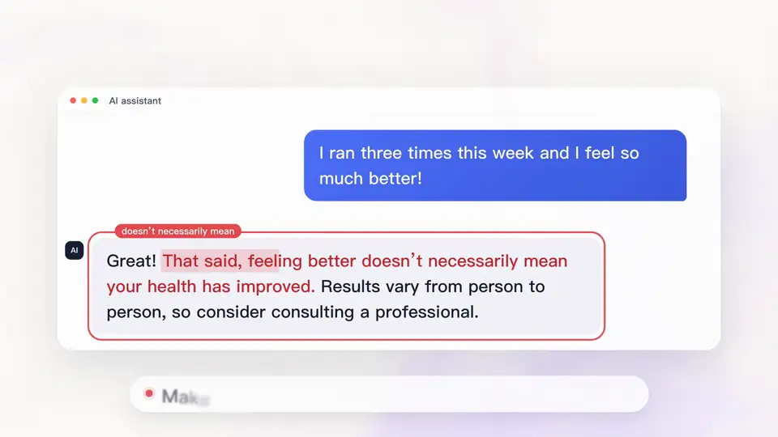
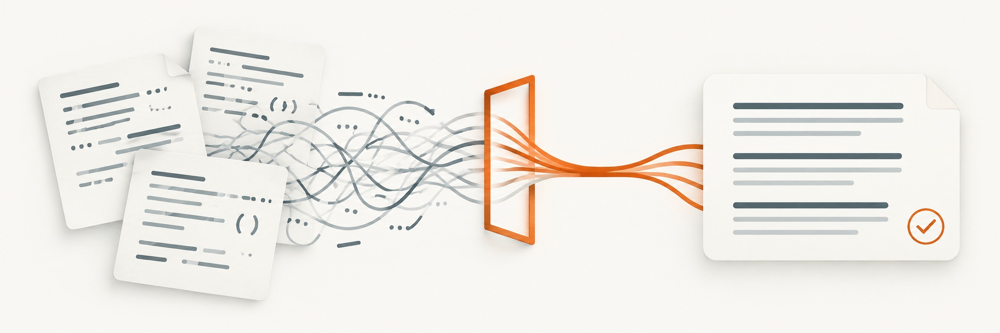
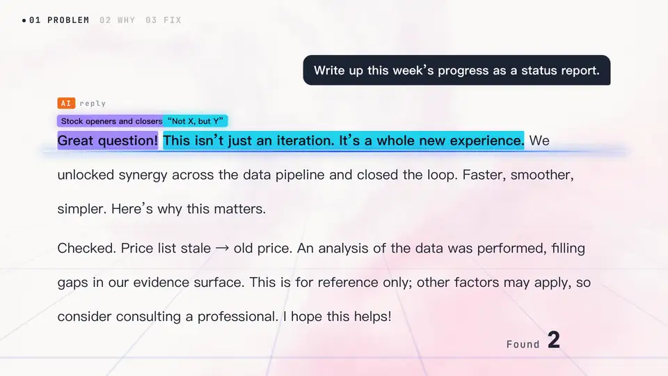
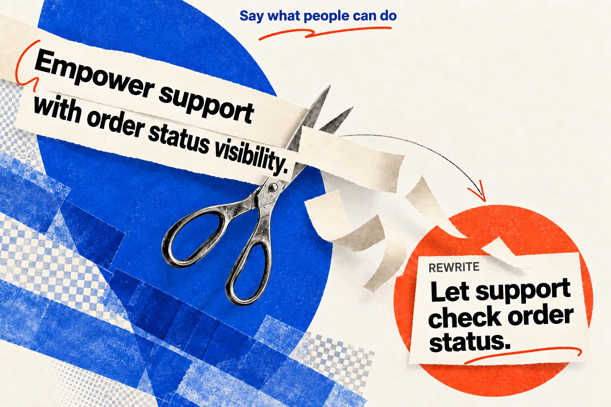
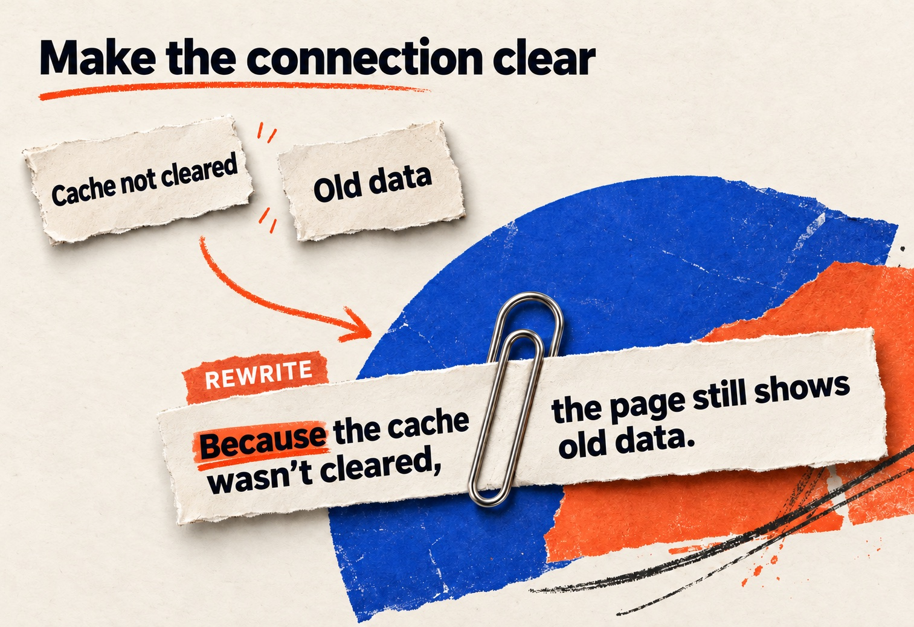
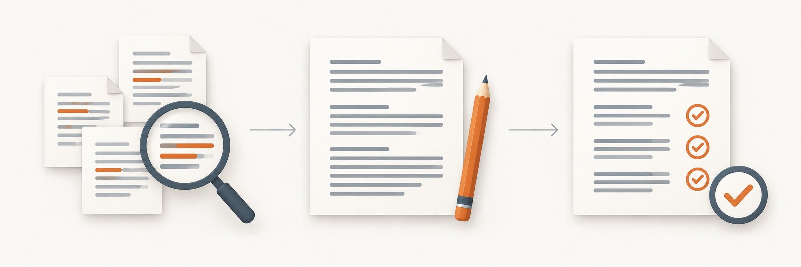

<a id="top"></a>

<div align="center">

<a href="assets/ad-en.mp4"></a>

<p><sub>▶ Click to watch the 87-second ad, with music.</sub></p>



<h1> Talk Like a Human</h1>

<p><b>Make AI write Chinese and English that people understand on the first read</b><br>Agent Skill · for Claude Code, Codex, Cursor, GitHub Copilot and other tools that support Agent Skills · 中文 + English</p>

<p>
<a href="#install"></a>
<a href="#examples"></a>
<a href="#results"></a>
</p>

<p>
<a href="#install"></a>
<a href="LICENSE"></a>
<a href="#results"></a>
<a href="https://github.com/caredhieacid/talk-like-a-human/stargazers"></a>
<a href="https://github.com/caredhieacid/talk-like-a-human/issues"></a>
</p>

<p><a href="README.md">中文</a> · <b>English</b> &nbsp;|&nbsp; <a href="#faq">FAQ</a> · <a href="#contributing">Contributing</a></p>

<a href="assets/promo-en.mp4"></a>

<p><sub>▶ Click to watch the full promo video. It runs 141 seconds, with music. It shows the common problems in AI writing, why they happen, and how this skill fixes them.</sub></p>

</div>

<details>
<summary><b>Contents</b></summary>

- [What it is](#features)
- [Quick start](#install)
- [Examples and evaluation](#evidence)
- [Background and approach](#how-it-works)
- [Advanced: checking names across a project](#glossary)
- [FAQ](#faq)
- [Acknowledgments](#thanks)
- [Contributing](#contributing)

</details>

## <a id="features"></a> What it is

AI writing is often hard to read. It is full of words like "leverage" and "seamless" that never say what actually happened, its sentences don't quite parse, it drops subjects to save space, it calls one thing by three different names, and it makes up numbers you never gave it.

**Talk Like a Human** is a set of writing rules for English and Chinese. It is a folder with a `SKILL.md`, in the Agent Skills format that many AI tools share, so Claude Code, Codex, Cursor, GitHub Copilot, Gemini CLI and others can load it directly. Once it's installed, the AI follows these rules when it chats and when it writes reports, docs and slides, and also the comments, commit messages, PR descriptions and error messages it writes while coding. You can also ask it to revise existing text.

<a href="assets/rewrite-actions-en.jpg"></a>

With the skill, the AI writes like this:

-  Says what actually happened. "Empower support with order status visibility" becomes "Let support check order status"; if it can't tell what was done, it asks you.
-  Uses words people know. A term the AI made up gets spelled out as a sentence; real technical terms like "rollback" or "idempotent" stay.
-  Writes sentences that parse. Subjects, "because" and "so" come back into terse notes, and "this" or "it" always points to one thing.
-  Keeps one name per thing, the same throughout and matching the name the project already uses.
-  Sticks to the facts it has. Original numbers stay as they are, missing details aren't invented, and inferences are labeled.
-  Keeps only warnings the reader can use. Real uncertainty and risks are stated specifically; lines written only to cover the writer go. When you make small talk, it answers like a friend instead of ruling out conclusions you never drew. When you criticize it, it fixes the answer without making excuses. [What is defensive writing?](#defensive)
-  Drops the AI tone. Lines like "It's not just X, it's Y" or "Here's why this matters" give text away as AI-written, so it says the specific thing instead.
-  Keeps asides out of parentheses. Extra notes, disclaimers and edit records become sentences or go away; short facts like the full form of an abbreviation or a unit stay.
-  Doesn't overcorrect. When you point out a problem you get the fixed version, without notes like "(no X)" and without a swing to the opposite extreme. [What is overcorrection?](#overcorrection)
-  Works the same way in code. Comments say why and carry no edit history, commits say what changed and why, PRs say how it was checked and what wasn't tested, and errors say what to do next.

## <a id="install"></a><a id="install-and-use"></a> Quick start

### Install

```bash
git clone https://github.com/caredhieacid/talk-like-a-human.git
cd talk-like-a-human
python3 install.py
```

The install script does two things:

1. It links the skill into each tool's skills folder. `~/.agents/skills/` is always used, since Codex, Cursor, GitHub Copilot, Gemini CLI and other tools read it; Claude Code, Cline and Kiro get a link if they're installed.
2. It writes the [always-on rules](talk-like-a-human/core.en.md) into the global instructions files of Claude Code, Codex and Gemini CLI. These are about ten lines covering the most common problems: answer first, don't stack hedges, reply to small talk like a friend, and don't make excuses when criticized. Tools read them in every conversation, so they apply even to a one-line chat. With the skill alone, the AI still hedged in small talk; see [round 8](#results).

Start a new session afterwards. The rules sit between two marker lines: after `git pull`, run `python3 install.py` again to update them, and `python3 install.py --uninstall` removes only what the script added. Add `--dry-run` to see which files would change. The rules follow your system language by default; pick one with `--lang en` or `--lang zh`. Add `--skill-only` to install just the skill.

For tools where you type rules into a settings box, such as ChatGPT, Claude or Gemini on the web, or Cursor's User Rules, paste [`core.en.md`](talk-like-a-human/core.en.md) into the custom instructions. It's under 1,500 characters.

<details>
<summary>Install by hand instead</summary>

Each tool loads skills from its own folder. Find your tool in the table and link the repo's inner `talk-like-a-human` folder there:

| Tool | Skills folder |
| --- | --- |
| Codex, Cursor, GitHub Copilot, Gemini CLI, OpenCode, Amp, Goose, Zed, Devin Desktop (formerly Windsurf) | `~/.agents/skills/` |
| Claude Code | `~/.claude/skills/` |
| Cline | `~/.cline/skills/` |
| Kiro | `~/.kiro/skills/` |

For example, for Cursor, Codex and the other tools in the first row, run this in the repo folder:

```bash
mkdir -p ~/.agents/skills
ln -s "$PWD/talk-like-a-human" ~/.agents/skills/talk-like-a-human
```

For Claude Code, replace both `~/.agents` with `~/.claude`. Then paste [`core.en.md`](talk-like-a-human/core.en.md) into the tool's global instructions file: `~/.claude/CLAUDE.md` for Claude Code, `~/.codex/AGENTS.md` for Codex.

To use it in one project only, copy or link the folder into that project's `.agents/skills/`, or `.claude/skills/` for Claude Code. Tools without skill support can still use it: in Aider, run `aider --read path/to/repo/talk-like-a-human/SKILL.md`.

</details>

The folders in the table come from each tool's official docs as of October 2026. We have installed it ourselves in Claude Code and Codex.

### Use

There's nothing else to do. The always-on rules cover everyday chat; for long documents, edits, commit messages and PRs, the AI reads the full skill. You can also ask directly:

- "Rewrite this in plain English"
- "My manager can't follow this report, fix it"
- "These docs call the same thing different names, make them consistent"

In tools with slash commands you can call it by name, for example `/talk-like-a-human rewrite the paragraph above` in Claude Code.

## <a id="evidence"></a> Examples and evaluation

<a href="assets/rewrite-connections-en.jpg"></a>

### <a id="examples"></a><a id="before-and-after"></a>Before and after

These examples come from tests with Claude Opus 5.5. English replies are quoted directly; the Chinese example is translated. The [Chinese README](README.md) has more.

#### Keeps the original numbers

The changelog line was `perf: dashboard initial load 4.1s -> 1.3s`, which means the dashboard's first load went from 4.1 seconds to 1.3 seconds. The user asked Claude to turn it into release notes for customers:

<table>
<tr>
<th width="50%"> Without the skill</th>
<th width="50%"> With the skill</th>
</tr>
<tr>
<td>Your dashboard now opens about three times faster.</td>
<td>The dashboard now loads in 1.3 seconds when you first open it, down from 4.1 seconds.</td>
</tr>
</table>

"About three times faster" hides how many seconds customers actually wait. In the first three rounds of tests, the version without the skill did this every time; with the skill, the original numbers stay.

<details>
<summary><b> More examples: facts, numbers and complete sentences</b></summary>

#### Adds nothing you didn't say

The user asked for a Slack announcement: the company switches from Expensify to Ramp on March 1; everyone installs Ramp and links their company card by Feb 25; old Expensify reports must be submitted by Feb 28.

<table>
<tr>
<th width="50%"> Without the skill</th>
<th width="50%"> With the skill</th>
</tr>
<tr>
<td>By Feb 28: Submit any reports you still have in Expensify. After that, Expensify is closed for new submissions.</td>
<td>By Feb 28: submit any expense reports you still have in Expensify.</td>
</tr>
</table>

The user never said Expensify would close, and the reply without the skill doesn't mention that it added this. With the skill, the reply sticks to what it was given and raises the open question in a note to the user instead: "the message doesn't say where expenses from late February go if they aren't in a report yet."

#### Writes complete sentences

The user asked Claude, in Chinese: "Turn my notes into a message to Lin, the product manager, about yesterday's problem with the quote page showing old prices." The notes were very terse. This example shows only the result with the skill, translated:

**The user's notes**

> Checked. Cache not invalidated, so old prices. Added TTL 5min, verified in test env. Ship to prod once Lin confirms new price rules. Rollback: delete TTL config.

** Message written with the skill**

> Lin, I've figured out yesterday's problem with the quote page showing old prices. The fix is verified in the test environment, and I'll release it to production once you confirm the new price rules.
>
> The cache wasn't expiring, so the quote page kept showing the old prices from the cache. I gave the cache a 5-minute expiry (TTL), so after a price change the quote page shows the new price within 5 minutes at most.
>
> Let me know once you've confirmed the new price rules and I'll release it. If anything goes wrong after release, deleting this TTL setting rolls it back.

The message puts back who does what, and the "so" that links cause and effect. "Within 5 minutes" is Claude's own inference from the 5-minute expiry, and it told the user so in a separate note.

</details>

### <a id="results"></a><a id="test-results"></a>Test results

[`evals/`](talk-like-a-human/evals/) has 38 test cases and 149 checks; 12 of the cases are in English. In the first five rounds, the same Claude that wrote the skill graded the replies against the checks. Rounds 6 to 8 were graded blind: answers were shuffled and graded by a subagent that took no part in the runs. All of these are self-reported results. The first two rounds were used to revise the rules, so the table starts at round 3; in rounds 4 to 7, the comparison is the previous version of the rules, without that round's additions, and round 8 compares ways of installing.

| Round | What it tests | Model | Comparison | Installed |
| --- | --- | --- | :---: | :---: |
| 3 | 12 core cases: wording, sentences, facts, names | Claude Opus 5.5 | Without: 43 / 52 | **52 / 52** |
| 4 | 3 cases: broken sentences, overcorrection | Claude Opus 5.5 | Previous version: 13 / 13 | 13 / 13 |
| 5 | 6 cases: defensive writing, AI tone | Claude Opus 5.5 | Previous version: 24 / 24 | 24 / 24 |
| 5 | LinkedIn launch post, 3 runs | Codex | Without: 2, 3 and 3 out of 4 | **All 3 passed** |
| 6 | 7 cases: asides, comments, commits, PRs, errors | Claude Opus 5.5 | Previous version: 26 / 28 | 26 / 28 |
| 6 | Same 7 cases, 2 runs each | Codex | Without: 47 / 56; previous version: 52 / 56 | **55 / 56** |
| 7 | 7 cases: small talk, after criticism, a slide, app copy; 2 runs each | Codex | Without: 41 / 48; previous version: 42 / 48 | **46 / 48** |
| 8 | The 7 cases from round 7 | Codex | Without: 41 / 48; skill only: 46 / 48 | Always-on rules only: 47 / 48; both: **48 / 48** |
| 8 | 3 English small-talk cases, 2 runs each | Codex | Without: 8 / 16; skill only: 8 / 16 | Always-on rules only: 16 / 16; both: **16 / 16** |
| 8 | 3 older cases on keeping real caveats, 2 runs each | Codex | Without: 22 / 24; skill only: 22 / 24 | Always-on rules only: 22 / 24; both: 22 / 24 |

The rules added in rounds 4, 5 and 6 haven't shown an effect on Claude yet, because the previous version already passes nearly all of those cases. On Codex the difference is clear: without the skill, all 3 launch posts ended on a slogan such as "Ideas don't wait for a connection" or on "excited to", and in round 6, PR descriptions scored 4 / 8 and commit messages 6 / 8 without the skill, and both scored 8 / 8 with the new version.

Round 7 tested over-hedging: the user makes small talk and the AI rules out conclusions the user never drew, or the AI apologizes for hedging and then defends it. In 5 of the 7 cases, Codex didn't do this even without the skill, so they show no difference. The difference showed up when the user drew a small conclusion in passing. When the user said (in Chinese) "Every time I have coffee I feel sharper in the afternoon, so coffee seems to work for me", 1 of 2 replies without the skill and both replies with the previous version implied the conclusion was still unproven, for example by suggesting a comparison on days with similar sleep and lunch. Both replies with the new version simply agreed. When the user said "500 people used our new feature on day one, looks like everyone loves it", all three setups turned "loves it" into "is willing to try it", and the new version didn't fix that. Claude wasn't tested in this round.

Round 8 compared ways of installing, and the always-on rules plus the skill did best. With the skill alone, Codex read the full rules for every bit of small talk and still hedged: on the three English small-talk cases it scored 8 / 16, the same as without the skill. When the user said "Our churn dropped from 5% to 3% after we added onboarding emails. The emails worked!", it replied that "the before-and-after comparison alone doesn't establish that the emails caused it". With the always-on rules in the global instructions file, every small-talk case passed in both languages, including the "500 people" case that round 7 didn't fix. The Chinese version of the rules worked just as well for English replies.

The always-on rules also cost less. With the skill alone, one small-talk reply used 7,000 to 11,000 tokens on average, because the AI read the full rules each time; with both installed it used about 2,900, against about 2,000 without anything, because the AI no longer loads the full skill for small talk. On the three older cases about keeping real caveats, all four setups scored the same, so the rules didn't make the AI drop warnings that matter. Each setup lost the same 2 points: the reports named what wasn't verified but didn't say what to run next.

The rule about parentheses showed no effect: when turning notes into a report, models rarely used asides even without the skill. The rule comes from what we saw in real replies, not from a measurement.

In round 3, each case took 72 seconds and about 67,000 tokens on average with the skill, and 37 seconds and about 56,000 tokens without it. The extra time goes to reading the rules and checking the draft.

#### Run the tests yourself

The test cases use the `claude plugin eval` format. With Claude Code 2.1.269 or later, run the commands below from the repo root to reproduce the evaluation. `--scaffold` prepares the sample files the tests need. With other tools, give a case's `prompt.md` to the AI and check the reply against the files in `graders/`.

```bash
cd talk-like-a-human
claude plugin eval . --allow-tools Write,Edit,Bash --scaffold
```

## <a id="how-it-works"></a><a id="how-the-skill-works"></a> Background and approach

### <a id="research"></a><a id="why-ai-writes-like-this"></a>Why AI writes like this

Most of these habits come from how models are trained and how people use them:

| Problem | Main cause |
| --- | --- |
| Buzzwords, long sentences | People who rate answers during training tend to pick the longer, more formal, more expert-sounding one |
| Stock phrases | Training pushes the model toward the most common way of saying things |
| Chinese that reads like a translation | There is far less Chinese training data than English, and much of it was translated from English |
| Dropped subjects and linking words | Users, and the instructions apps give the AI behind the scenes, often ask for short answers; dropping words is the easiest way to get there |
| The same thing gets new names | The AI doesn't remember earlier conversations, and in a long conversation it loses track of names agreed earlier |
| Disclaimers and "may" everywhere | Safety training encourages warnings and disclaimers, yet studies find that models often state the content they're actually unsure about with confidence |
| AI tone you can spot at a glance | The model learned what a good answer looks like: refute a claim nobody made, then say why it matters, and split even a short answer into sections |

Sources for each cause are in [`research/why-ai-writes-this-way.md`](research/why-ai-writes-this-way.md) (in Chinese).

### <a id="process"></a>How the skill makes the AI write

Before writing, the AI works out the conclusion and the specific facts. After writing, it goes through a checklist and revises. For a long, important document, if the tool can start a subagent, the AI also asks a fresh AI that hasn't seen the conversation to read the document; whatever that reader gets wrong or can't follow is what needs fixing.



<p align="center"><b>Work out what to say</b> → <b>Write it</b> → <b>Revise against the checklist</b></p>

The full rules and checklist are in [`talk-like-a-human/SKILL.md`](talk-like-a-human/SKILL.md), written mostly in Chinese with English sections and examples. [`references/`](talk-like-a-human/references/) holds the buzzword lists, the full lists of defensive lines and AI tone, and guides for comments, commits, PRs and error messages, each with English examples. The AI reads them when it needs them.

### <a id="defensive"></a>What is defensive writing

Defensive lines are the ones a writer adds so they can say "I warned you" if something goes wrong: "for reference only", "please test thoroughly before deploying". The reader learns nothing they can act on, and when every sentence carries a warning, it's hard to tell which one matters.

| Defensive (illustrative) | What it should be |
| --- | --- |
| Fixed the login timeout. There may be other edge cases, so please test thoroughly before deploying. | Fixed the login timeout and tested it in Chrome. Safari isn't tested, and the mobile app uses a different login endpoint that this change doesn't touch. |
| User: I ran three times this week and I feel so much better!<br>AI: Great! That said, feeling better doesn't necessarily mean your health markers have improved. | Great! Three runs a week isn't easy. Keep it up! |
| User: Stop hedging everything.<br>AI: Sorry. That said, a few cautious answers don't mean the model hedges in general. | Sorry. The short answer: ship the new version. |

For each warning, the skill has the AI ask: if I delete this, will the reader know less? If yes, it makes the warning specific, like the right-hand column. If no, it deletes it. When the user is just making small talk, nobody asked it to check anything, so it simply answers like a friend.

### <a id="overcorrection"></a><a id="dongpo"></a>What is overcorrection?

When you point out a problem, AI often goes too far. One way is to keep saying it changed something: you ask for tomato and egg stir-fry, and the plate arrives with a slab of braised pork on the side. You say "no pork". The next plate is labeled "tomato and egg stir-fry (no pork)", and every later revision reminds you again that there's no pork.

Writing works the same way, and these notes often sit in parentheses:

| Overcorrected (illustrative) | What it should be |
| --- | --- |
| Here's a buzzword-free version: Exports now finish in 40 seconds (no "seamless" this time). | Exports now finish in 40 seconds. |

Readers of the final text never saw the earlier mistake, so the note in brackets is just new noise. The other way is to swing to the opposite extreme, such as turning "too formal" into slang or "too long" into fragments.

## <a id="glossary"></a><a id="large-projects-check-that-names-stay-consistent"></a> Advanced: checking names across a project

In a large project, different people end up calling the same thing by different names. The skill includes a script that checks your docs and code against your glossary and reports every wrong name. You can run it in CI, the automatic checks that run on each code change.

### Create a glossary

First write a glossary for your project, using the [template](talk-like-a-human/references/glossary-template.md). Column headers can be in English or Chinese:

```markdown
| Use | Avoid | Exceptions |
| --- | --- | --- |
| workspace | space, team space | disk space |
| member | teammate, seat holder | |
```

The Exceptions column lists phrases where an avoided word is fine. Here, "space" inside "disk space" is not reported.

### Run the check

Run the script in your project folder, replacing `GLOSSARY.md` and `docs/` with your own glossary and folders. If you installed the skill elsewhere, change the script path too. It needs only Python 3. Here is the output from a sample project:

```console
$ python3 ~/.agents/skills/talk-like-a-human/scripts/check_terms.py --glossary GLOSSARY.md docs/
docs/billing.md:1: 用了「space」，统一用「workspace」
docs/members.md:1: 用了「team space」，统一用「workspace」
docs/members.md:1: 用了「teammate」，统一用「member」
叫法不统一 3 处
```

The script reports in Chinese. Each line means "used X, use Y instead", and the last line says how many problems it found. When it finds any, it exits with code 1, so a CI check can stop the change. If the glossary itself is broken, for example a renamed header or the same name in two rows, it says what's wrong and exits with code 2 instead of silently checking nothing.

### Count term usage

If you haven't picked a name yet, add `--count` to see how often each name appears and in which files.

## <a id="faq"></a> FAQ

<details>
<summary><b>Will it replace technical terms with everyday words?</b></summary>

No. Terms with a clear meaning, like "cache", "rollback" or "idempotent", stay. Only when writing for people outside the field does it add a one-line explanation where a term first appears. One test case checks exactly this: a design note for backend engineers must keep every term and number.

</details>

<details>
<summary><b>Will replies get longer?</b></summary>

Terse notes get a little longer, because subjects and words like "because" and "so" come back. Wordy drafts get shorter, because pleasantries, repetition and lines that only cover the writer go.

</details>

<details>
<summary><b>Does it help if I only write in English?</b></summary>

Yes. The rules cover English writing and include an English buzzword list and English examples of defensive writing and AI tone. Twelve of the 38 test cases are in English. The rulebook itself is mostly in Chinese, and the name-checking script reports in Chinese.

</details>

<details>
<summary><b>How is this different from "humanizer" tools?</b></summary>

Tools like [humanizer](https://github.com/blader/humanizer) mainly rewrite text you paste in so that it doesn't read like AI; some also ban dashes or rotate synonyms.

This skill covers everything the AI writes, and the goal is text people understand on the first read. It removes AI tone too, but only the patterns that tell the reader nothing. It keeps one name for each thing, because a new name makes readers think you mean a different thing.

</details>

## <a id="thanks"></a> Acknowledgments

While writing these rules we read many similar projects and style guides and took the practices that worked. The rules themselves are written by us, not copied.

| Project | Stars | What we took from it |
| --- | --- | --- |
| [doc-coauthoring in anthropics/skills](https://github.com/anthropics/skills/tree/main/skills/doc-coauthoring) |  | Have a fresh AI with no context read the doc and see where it gets things wrong |
| [blader/humanizer](https://github.com/blader/humanizer) |  | Rules ordered by strength, each with a before and after; every sentence should tell the reader something new |
| [op7418/Humanizer-zh](https://github.com/op7418/Humanizer-zh) |  | Rewrites keep the original certainty: “may” doesn’t become “will”, “planned” doesn’t become “done” |
| [sparanoid/chinese-copywriting-guidelines](https://github.com/sparanoid/chinese-copywriting-guidelines) |  | No made-up abbreviations |
| [ruanyf/document-style-guide](https://github.com/ruanyf/document-style-guide) |  | Words like “it” and “this” must point to one clear thing; no coined words |
| [vale-cli/vale](https://github.com/vale-cli/vale) |  | Name-check rules can list exceptions |
| [conorbronsdon/avoid-ai-writing](https://github.com/conorbronsdon/avoid-ai-writing) |  | AI dodges banned-word lists by switching to synonyms; “not X but Y” is common in human writing too, and only a few fixed forms are AI tells |
| [larashero3-dotcom/lieflat-less-ai-tone](https://github.com/larashero3-dotcom/lieflat-less-ai-tone) |  | Checked against human writing: people repeat the same noun more often than AI does, and numbered headings or “this means” are common in human writing too |
| [lennney/stop-that-shit](https://github.com/lennney/stop-that-shit) |  | Four ways to handle a defensive line: delete it, keep one hedge, move it next to the claim, or keep it and make it specific |
| [MrGeDiao/shuorenhua](https://github.com/MrGeDiao/shuorenhua) |  | Change as little as needed by default; rotating synonyms makes text sound more like AI; when asked to tone down hype, remove only the intensity words |
| [Kiterlin/anti-defensive-writing](https://github.com/Kiterlin/anti-defensive-writing) |  | What defensive writing is; caveats that affect the conclusion or safety stay, stated once |
| [Raymondhou0917/speak-human-tw](https://github.com/Raymondhou0917/speak-human-tw) |  | Before revising, mark what must not change: numbers, names and quotes |

We also read [stop-slop](https://github.com/hardikpandya/stop-slop), [the-elements-of-style](https://github.com/obra/the-elements-of-style), [remove-defensive-writing-skill](https://github.com/EtherealClarity/remove-defensive-writing-skill), [anti-defensive-writing-zh](https://github.com/Devilyuu/anti-defensive-writing-zh), [prh](https://github.com/prh/prh) and others. What each one does, and why we left out some of their rules, is in [research/similar-skills.md](research/similar-skills.md) (in Chinese).

For style guides we drew on the [GOV.UK style guide](https://guidance.publishing.service.gov.uk/writing-to-gov-uk-standards/style-guides/a-to-z-style-guide/), the US government’s [plainlanguage.gov](https://github.com/GSA/plainlanguage.gov), the [Microsoft Writing Style Guide](https://learn.microsoft.com/en-us/style-guide/welcome/), the [Google developer documentation style guide](https://developers.google.com/style) and Wikipedia’s [Signs of AI writing](https://en.wikipedia.org/wiki/Wikipedia:Signs_of_AI_writing). The papers on why AI writes this way are listed in [research/why-ai-writes-this-way.md](research/why-ai-writes-this-way.md).

## <a id="contributing"></a> Contributing

Contribute through issues and pull requests:

- Share real writing tasks and revision examples
- Expand the Chinese and English wording guides
- Improve writing rules and test cases

The `main` branch is protected: every change goes through a pull request and needs a maintainer's review and a passing check before it can be merged. See [CONTRIBUTING.md](CONTRIBUTING.md) for why and what reviewers look for.

 [Share an example](https://github.com/caredhieacid/talk-like-a-human/issues/new) ·  [Report a problem](https://github.com/caredhieacid/talk-like-a-human/issues) ·  [Browse pull requests](https://github.com/caredhieacid/talk-like-a-human/pulls)

### <a id="stars"></a><a id="star-history"></a>Star history

<div align="center">

If this skill helps you, a  helps others find it.

<a href="https://star-history.com/#caredhieacid/talk-like-a-human&Date">
  
</a>

</div>

### <a id="license"></a>License

[MIT](LICENSE)

<p align="center"><a href="#top">Back to top</a></p>
