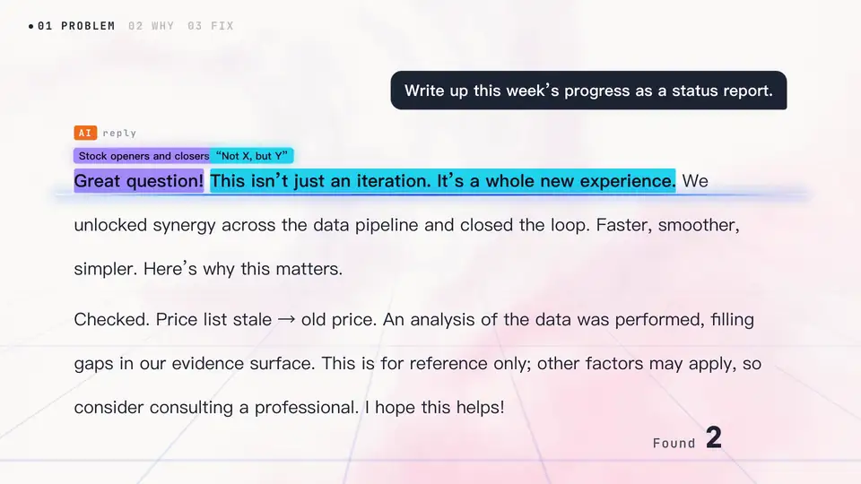
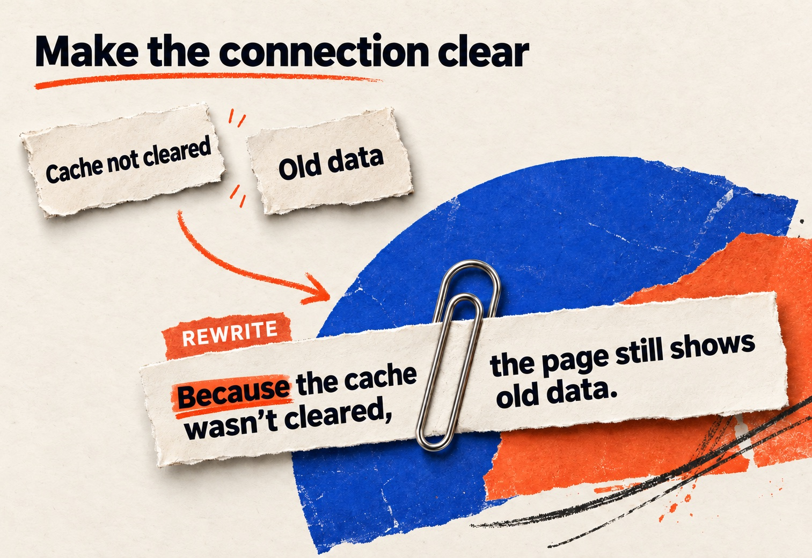
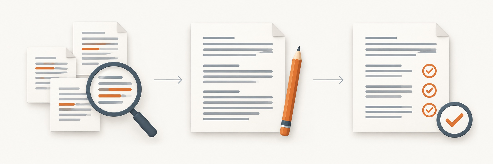
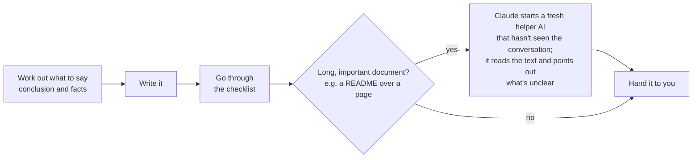

<a id="top"></a>

<div align="center">


<h1> Talk Like a Human</h1>

<p><b>Make AI write Chinese and English that people understand on the first read</b><br>Claude Code skill · 中文 + English</p>

<p>
<a href="#install"></a>
<a href="#examples"></a>
<a href="#results"></a>
</p>

<p>
<a href="#install"></a>
<a href="LICENSE"></a>
<a href="#results"></a>
<a href="https://github.com/caredhieacid/talk-like-a-human/stargazers"></a>
<a href="https://github.com/caredhieacid/talk-like-a-human/issues"></a>
</p>

<p><a href="README.md">中文</a> · <b>English</b> &nbsp;|&nbsp; <a href="#faq">FAQ</a> · <a href="#contributing">Contributing</a></p>

<a href="assets/promo-en.mp4"></a>

<p><sub>▶ Click to watch the full promo video (102 seconds, with music). The first half explains why AI writing gets hard to read; the second half shows how this skill fixes it.</sub></p>

</div>

<details>
<summary><b>Contents</b></summary>

- [Overview](#features)
- [Quick start](#install)
- [Examples and evaluation](#evidence)
- [How it works](#how-it-works)
- [Advanced usage](#glossary)
- [FAQ](#faq)
- [Contributing](#contributing)

</details>

## <a id="features"></a> Overview

**Talk Like a Human** is a Chinese and English writing skill for Claude Code, built around **clear expression, factual fidelity and consistent terminology**. Use it to draft or revise chat replies, reports, proposals, docs and commit messages, making text easier to read while preserving its meaning.

AI writing is often hard to read. It is full of buzzwords like "leverage" and "seamless", it invents terms nobody else uses, it drops subjects and linking words to save space, it calls one thing by three different names, and it changes or makes up numbers.

<a href="assets/rewrite-actions-en.jpg"></a>

-  **No buzzwords**: Say what was actually done instead of “leverage” or “synergy”. Technical terms stay.
-  **No made-up terms**: Use familiar words instead of new terms only the AI understands.
-  **Natural sentences**: Avoid phrasing that reads like a word-for-word translation.
-  **Complete sentences**: Keep the subject and words like “because” and “so”.
-  **One name per thing**: Call the same thing by the same name throughout.
-  **No invented facts**: Keep the original numbers. Label inferences and ask for missing details.

## <a id="install"></a><a id="install-and-use"></a> Quick start

### Install

With Claude Code and git installed, run these commands in a macOS or Linux terminal:

```bash
git clone https://github.com/caredhieacid/talk-like-a-human.git
cd talk-like-a-human
mkdir -p ~/.claude/skills
ln -s "$PWD/talk-like-a-human" ~/.claude/skills/talk-like-a-human
```

> [!TIP]
> The repo contains a folder with the same name, `talk-like-a-human`. That inner folder is the skill itself. The last command creates a symbolic link (a shortcut) to it in `~/.claude/skills/`, so running `git pull` in the repo also updates the skill. If you'd rather not use a link, copy the inner folder into `~/.claude/skills/` instead.

### Use

Once installed, Claude applies the rules when they fit the writing task. You can also request a rewrite directly in Claude Code:

- "Rewrite this in plain English"
- "My manager can't follow this report, fix it"
- "These docs call the same thing different names, make them consistent"

You can also call the skill directly in Claude Code's prompt, for example `/talk-like-a-human rewrite the paragraph above`.

> [!NOTE]
> To use the skill for every reply, add this line to `~/.claude/CLAUDE.md`: `Write everything meant for people according to the talk-like-a-human skill.` Claude Code reads this file at the start of every conversation; create it if it doesn't exist.

## <a id="evidence"></a> Examples and evaluation

<a href="assets/rewrite-connections-en.jpg"></a>

### <a id="examples"></a><a id="before-and-after"></a>Before and after

These examples come from tests with Claude Opus 5.5. They include comparisons of the same task with and without the skill, plus an example of the skill turning terse notes into complete sentences. English replies are quoted directly; the Chinese example is translated. See the [Chinese README](README.md) for additional examples.

#### Keeps the original numbers

The changelog line was `perf: dashboard initial load 4.1s -> 1.3s`, which means the dashboard's first load went from 4.1 seconds to 1.3 seconds. The user asked Claude to turn it into release notes for customers:

<table>
<tr>
<th width="50%"> Without the skill</th>
<th width="50%"> With the skill</th>
</tr>
<tr>
<td>Your dashboard now opens about three times faster.</td>
<td>The dashboard now loads in 1.3 seconds when you first open it, down from 4.1 seconds.</td>
</tr>
</table>

**What changed**

- **Without the skill:** "About three times faster" hides how many seconds customers actually wait. We ran three rounds of tests, and without the skill it did this every time.
- **With the skill:** The original numbers stay.

<details>
<summary><b> More examples: facts, numbers and complete sentences</b></summary>

#### Adds nothing you didn't say

The user asked for a Slack announcement: the company switches from Expensify to Ramp on March 1; everyone installs Ramp and links their company card by Feb 25; old Expensify reports must be submitted by Feb 28.

<table>
<tr>
<th width="50%"> Without the skill</th>
<th width="50%"> With the skill</th>
</tr>
<tr>
<td>By Feb 28: Submit any reports you still have in Expensify. After that, Expensify is closed for new submissions.</td>
<td>By Feb 28: submit any expense reports you still have in Expensify.</td>
</tr>
</table>

**What changed**

- **Without the skill:** The user never said Expensify would close, and the reply doesn't mention that this line was added.
- **With the skill:** It sticks to what it was given. In a note to the user it raised the open question instead: "the message doesn't say where expenses from late February go if they aren't in a report yet."

#### Writes complete sentences

The user asked Claude, in Chinese: "Turn my notes into a message to Lin, the product manager, about yesterday's problem with the quote page showing old prices." The notes were very terse. This example shows only the result with the skill, and both columns are translated:

**The user's notes**

> Checked. Cache not invalidated, so old prices. Added TTL 5min, verified in test env. Ship to prod once Lin confirms new price rules. Rollback: delete TTL config.

** Message written with the skill**

> Lin, I've figured out yesterday's problem with the quote page showing old prices. The fix is verified in the test environment, and I'll release it to production once you confirm the new price rules.
>
> The cache wasn't expiring, so the quote page kept showing the old prices from the cache. I gave the cache a 5-minute expiry (TTL), so after a price change the quote page shows the new price within 5 minutes at most.
>
> Let me know once you've confirmed the new price rules and I'll release it. If anything goes wrong after release, deleting this TTL setting rolls it back.

The message puts back who does what, and the "so" that links cause and effect. The "within 5 minutes" line is Claude's own inference from the 5-minute expiry. In a separate note to the user (not shown here), it said so. The skill allows inferences as long as they are labeled.

</details>

### <a id="results"></a><a id="test-results"></a>Test results

[`evals/`](talk-like-a-human/evals/) provides 12 test cases and 52 checks covering writing quality, factual fidelity and consistent terminology. Four cases verify that already-clear text is preserved.

The project completed three rounds of comparative evaluation, refining the rules after each of the first two. Each round used Claude Opus 5.5 to run tasks with and without the skill. The table shows self-test results from the third round:

| Metric |  With the skill |  Without the skill |
| --- | :---: | :---: |
| Checks passed | **52 / 52** | 43 / 52 |
| Average time | 72 s | 37 s |
| Average tokens | ~67,000 | ~56,000 |

Time and token measurements cover the full process: reading the rules, generating text and reviewing the result.

**Evaluation setup:** Each test case ran once per configuration in each round. Grading was performed by the same Claude, in the same conversation, that authored the skill.

#### Run the tests yourself

With Claude Code 2.1.269 or later, run these commands from the repo root to reproduce the evaluation. `--scaffold` prepares the sample files required by the tests:

```bash
cd talk-like-a-human
claude plugin eval . --allow-tools Write,Edit,Bash --scaffold
```

## <a id="how-it-works"></a><a id="how-the-skill-works"></a> How it works

The skill guides Claude through three steps: establish the facts, write clearly and review the text. Claude identifies the conclusion and supporting facts, drafts the response, then checks wording, sentence structure and factual fidelity:



<p align="center"><b>Establish the facts</b> → <b>Write clearly</b> → <b>Review the text</b></p>

<details>
<summary><b>Full workflow, including a fresh review of long documents</b></summary>



</details>

<details>
<summary><b>The checklist</b></summary>

- Is there a word the reader has to guess at? Swapping one vague word for another vague word doesn't count as fixing it.
- Is there a made-up term that isn't explained where it first appears?
- Is there a metaphor where a plain statement would do, or a vague phrase like "related issues" that never says which ones?
- Is there a sentence that needs a second read?
- Did anything get dropped to save words: the subject, "because", or who does what?
- Is each thing called by one name throughout, and the same name the project already uses?
- Are there made-up numbers, details or examples, or anything stated more firmly than the source?
- Does the text mention something the reader hasn't seen, and fail to explain what it is?
- Is the first sentence the thing the reader most wants to know?

</details>

The full rules are in [`talk-like-a-human/SKILL.md`](talk-like-a-human/SKILL.md). It is written mostly in Chinese, with English sections and examples. The English buzzword list is [`references/en-jargon.md`](talk-like-a-human/references/en-jargon.md).

### <a id="research"></a><a id="why-ai-writes-like-this"></a>Why AI writes like this

The AI can write plainly. The way it is trained, and the way people use it, push it toward these habits:

| Problem | Main cause |
| --- | --- |
| Buzzwords, long sentences | People who rate answers during training tend to pick the longer, more formal, more expert-sounding one |
| Stock phrases | Training pushes the model toward the most common way of saying things |
| Chinese that reads like a translation | There is far less Chinese training data than English, and much of it was translated from English |
| Dropped subjects and linking words | Users, and the instructions apps give the AI behind the scenes, often ask for short answers; dropping words is the easiest way to get there |
| The same thing gets new names | The AI doesn't remember earlier conversations, and in a long conversation it loses track of names agreed earlier |

Sources for each cause are in [`research/why-ai-writes-this-way.md`](research/why-ai-writes-this-way.md) (in Chinese).

## <a id="glossary"></a><a id="large-projects-check-that-names-stay-consistent"></a> Advanced: consistent terminology

The included script checks docs and code against your project glossary, locates inconsistent names and supports automated checks in CI.

### Create a glossary

First write a glossary for your project (see the [template](talk-like-a-human/references/glossary-template.md)). Column headers can be in English or Chinese:

```markdown
| Use | Avoid | Exceptions |
| --- | --- | --- |
| workspace | space, team space | disk space |
| member | teammate, seat holder | |
```

The Exceptions column lists phrases where an avoided word is fine. Here, "space" inside "disk space" is not reported.

### Run the check

Then run the name-checking script in your project folder, replacing `GLOSSARY.md` and `docs/` with your own glossary and folders. It needs Python 3 and uses only what comes with Python, so there's nothing extra to install. Here is the output from a sample project:

```console
$ python3 ~/.claude/skills/talk-like-a-human/scripts/check_terms.py --glossary GLOSSARY.md docs/
docs/billing.md:1: 用了「space」，统一用「workspace」
docs/members.md:1: 用了「team space」，统一用「workspace」
docs/members.md:1: 用了「teammate」，统一用「member」
叫法不统一 3 处
```

The name-checking script reports its results in Chinese. Each line means "used X, use Y instead", and the last line says how many problems it found. When it finds any, it exits with code 1, so an automated check on each code change (CI) can stop the change.

### Count term usage

Use `--count` to list how often each name appears and in which files, giving you a basis for choosing consistent project terminology.

## <a id="faq"></a> FAQ

<details>
<summary><b>Will it replace technical terms with everyday words?</b></summary>

No. Terms with a clear meaning, like "cache", "rollback" or "idempotent", stay. Only when writing for people outside the field does it add a one-line explanation where a term first appears. One test case checks exactly this: a design note for backend engineers must keep every term and number.

</details>

<details>
<summary><b>How does it control response length?</b></summary>

The rules prioritize complete, readable sentences. Terse notes gain the subjects and causal links readers need; long drafts lose pleasantries and repetition. Length follows the content, while tone and technical detail suit the reader and context.

</details>

<details>
<summary><b>Does it help if I only write in English?</b></summary>

Yes. The rules cover English writing and include a dedicated English buzzword list. Three of the 12 test cases are in English, and all of their checks passed with the skill. The rulebook is primarily in Chinese, with English rules and examples; the name-checking script also uses Chinese for its diagnostics.

</details>

<details>
<summary><b>How is this different from "humanizer" tools?</b></summary>

Tools like [humanizer](https://github.com/blader/humanizer) mainly rewrite text you paste in so that it doesn't read like AI. Some also ban dashes or keep swapping a word for its synonyms.

This skill aims for text people understand on the first read. It covers everything Claude writes, not just text you paste in, and it doesn't use tricks like banning dashes or swapping synonyms, because swapping synonyms makes readers think you mean different things. The skill also includes a name-checking script for whole projects.

</details>

<details>
<summary><b>Which tool is this skill designed for?</b></summary>

The project provides installation commands, direct invocation and global configuration for Claude Code. The writing rules use the `SKILL.md` format; adaptations for other tools should follow their skill-loading conventions.

</details>

## <a id="contributing"></a> Contributing

Contribute through issues and pull requests:

- Share real writing tasks and revision examples
- Expand the Chinese and English wording guides
- Improve writing rules and test cases

 [Share an example](https://github.com/caredhieacid/talk-like-a-human/issues/new) ·  [Report a problem](https://github.com/caredhieacid/talk-like-a-human/issues) ·  [Browse pull requests](https://github.com/caredhieacid/talk-like-a-human/pulls)

### <a id="stars"></a><a id="star-history"></a>Star history

<div align="center">

If this skill helps you, a  helps others find it.

<a href="https://star-history.com/#caredhieacid/talk-like-a-human&Date">
  
</a>

</div>

### <a id="license"></a>License

[MIT](LICENSE)

<p align="center"><a href="#top">Back to top</a></p>
