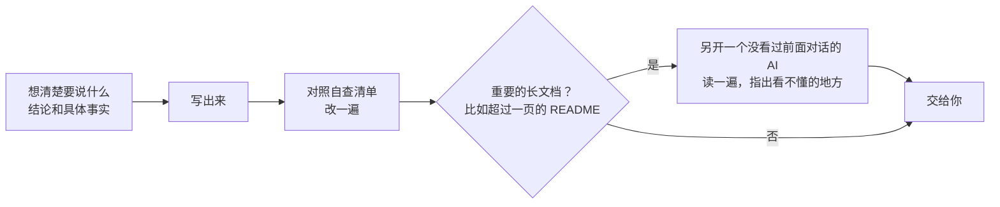

<a id="top"></a>

<div align="center">


<h1> 像人一样说话</h1>

<p><b>让 AI 写出读一遍就懂的中文和英文</b><br>Agent Skill · Claude Code、Codex、Cursor、GitHub Copilot 等主流 AI 工具都能用 · 中文 + English</p>

<p>
<a href="#install"></a>
<a href="#examples"></a>
<a href="#results"></a>
</p>

<p>
<a href="#install"></a>
<a href="LICENSE"></a>
<a href="#results"></a>
<a href="https://github.com/caredhieacid/talk-like-a-human/stargazers"></a>
<a href="https://github.com/caredhieacid/talk-like-a-human/issues"></a>
</p>

<p><b>中文</b> · <a href="README.en.md">English</a> &nbsp;|&nbsp; <a href="#faq">常见问题</a> · <a href="#contributing">参与贡献</a></p>

<a href="assets/promo-zh.mp4"></a>

<p><sub>▶ 点击上图观看完整宣传片（102 秒，有配乐）。前半段讲 AI 为什么不说人话，后半段介绍这个 skill 怎么解决。</sub></p>

</div>

<details>
<summary><b>目录</b></summary>

- [功能概览](#features)
- [快速开始](#install)
- [效果与测试](#evidence)
- [工作原理](#how-it-works)
- [进阶用法](#glossary)
- [常见问题](#faq)
- [参与贡献](#contributing)

</details>

## <a id="features"></a> 功能概览

**像人一样说话**是一个中英文写作 skill，专注于**清晰表达、忠实保留事实、统一术语**。它用通用的 Agent Skills 格式（一个带 `SKILL.md` 的文件夹），Claude Code、Codex、Cursor、GitHub Copilot、Gemini CLI 等主流 AI 工具都能直接加载。适用于聊天回复、周报、方案、文档和代码提交说明，支持从头写作与已有稿件改写。

AI 写的东西常常让人读不懂：满是“赋能”“闭环”“leverage”这类听着专业、却说不清具体意思的词，自己造新词，句子像翻译过来的、甚至读不通，为了省字把主语删掉，同一个东西前后换好几个名字，还会编出你没给过的数字。它还爱给自己留后路，满篇“仅供参考”“可能”“请谨慎操作”；开头“好问题！”、结尾“希望对你有帮助”这类套话，一眼就能认出是 AI 写的。你指出问题以后，它又常常改过头。

<a href="assets/rewrite-actions-zh.jpg"></a>

-  **不说黑话**：不写“赋能”“闭环”，直接写具体做了什么。
-  **不自造词**：不写“证据面”这种只有 AI 自己懂的新词。
-  **句子要通顺**：写“清洗了数据”，不写“对数据进行了清洗”；也不出“通过……使……”这类缺主语的病句。
-  **句子要完整**：不为了省字删掉主语和“因为”“所以”。
-  **叫法统一**：同一个东西，从头到尾只用一个名字。
-  **不乱编**：不补没给过的数字、细节和例子；推断要说明。
-  **不写防御性的话**：不加“仅供参考”“请谨慎操作”这类给自己留后路的话；真不确定的地方，说清哪里不确定、怎么确认。[举个例子](#defensive)
-  **去掉 AI 腔**：不写“这不是……而是……”“这一点非常重要”“更快、更稳、更省心”这类一眼就能认出的套路，换成具体内容。
-  **不矫枉过正**：指出问题后直接改好，不端上“西红柿炒鸡蛋（没有东坡肉）”。[这是什么意思？](#dongpo)

### <a id="dongpo"></a>什么是“东坡肉”问题

让 AI 做一道西红柿炒鸡蛋，它端上来的盘子里多了一块东坡肉。你说“别放东坡肉”，下一盘变成了“西红柿炒鸡蛋（没有东坡肉）”，之后每改一段，它都要再强调一句“不含东坡肉”。

写文字也一样。你指出一个问题，AI 改的时候总把这个问题挂在嘴上，或者一下子改到另一个极端：

| 改过头的写法（示意） | 应该的写法 |
| --- | --- |
| 以下是去掉黑话的版本：本周我们把投放数据和转化数据连了起来（没有使用“打通”“闭环”等说法）。 | 本周我们把投放数据和转化数据连了起来。 |

读最终版本的人不知道之前出过什么问题，这些说明就成了新的噪音。这个 skill 要求：被指出问题后直接给出改好的内容，不在正文里写“（没有××）”“不含××”，不宣布“以下是不带××的版本”；也不反着改过头，比如嫌太正式就改成网络口语，嫌太长就把主语和因果一起删掉。

### <a id="defensive"></a>什么是防御性写法

防御性的话是写的人为了“万一错了不怪我”加上去的。读的人从里面得不到能用的信息；满篇提醒和“可能”，反而分不清哪一句是真要紧的。

| 防御性的写法（示意） | 应该的写法 |
| --- | --- |
| 已修复登录超时问题。可能还存在其他边界情况，建议上线前充分测试。 | 登录超时修好了，在 Chrome 上测过。Safari 没测；手机端走的是另一套登录接口，这次没改。 |
| 以上内容仅供参考，具体请咨询专业人士。 | 直接给出具体信息；真有需要找医生、律师的情况，说清什么情况下找谁。 |

这个 skill 让 AI 对每句提醒、限定和免责先问一句：删掉它，读者会少知道什么，或者更容易做错什么吗？然后决定删掉、只留一层、挪到它限定的那句话旁边，还是留下并写具体。

去掉防御性的话，不等于把话说满。真不确定的地方照样要说，会删数据、不能撤销、涉及钱和健康的风险照样要提醒，只是要写具体，只写一次。

## <a id="install"></a><a id="安装和使用"></a> 快速开始

### 安装

这个 skill 用的是 Agent Skills 格式：一个文件夹，里面的 `SKILL.md` 写着规则。Claude Code、Codex、Cursor 等工具都认这个格式，只是读取的目录不同。先把仓库下载到本地：

```bash
git clone https://github.com/caredhieacid/talk-like-a-human.git
cd talk-like-a-human
```

然后在表里找到你用的工具，把仓库里的 `talk-like-a-human` 文件夹链接到对应的目录：

| 工具 | 放在哪个目录 |
| --- | --- |
| Codex、Cursor、GitHub Copilot、Gemini CLI、OpenCode、Amp、Goose、Zed、Devin Desktop（原 Windsurf） | `~/.agents/skills/` |
| Claude Code | `~/.claude/skills/` |
| Cline | `~/.cline/skills/` |
| Kiro | `~/.kiro/skills/` |

比如用 Cursor、Codex 这些工具，在刚才的仓库目录里运行：

```bash
mkdir -p ~/.agents/skills
ln -s "$PWD/talk-like-a-human" ~/.agents/skills/talk-like-a-human
```

用 Claude Code，就把两处 `~/.agents` 换成 `~/.claude`。只用一个工具，做它对应的那一步就够了；同时用几个工具，每个目录各建一个链接。命令里的 `$PWD` 指当前目录，所以要在仓库目录里运行。

> [!TIP]
> 用链接安装的话，以后在仓库里运行 `git pull`，skill 会跟着更新。只想在某个项目里用，就把文件夹复制或链接到那个项目的 `.agents/skills/`（Claude Code 是 `.claude/skills/`）。
>
> 不支持 skill 的工具也能用：Aider 可以运行 `aider --read 仓库路径/talk-like-a-human/SKILL.md`；其他工具可以在它的规则文件（比如 `AGENTS.md`）里写一句“写给人看的文字，按 /你的仓库路径/talk-like-a-human/SKILL.md 的规则写”，路径要写完整。

表里的目录来自各工具 2026 年 10 月的官方文档。我们实际装过试过的是 Claude Code 和 Codex：Codex 遇到改写任务时，会自己从 `~/.agents/skills/` 加载这个 skill。

### 使用

装好以后，AI 写给人看的文字时会按需用上这套规则。也可以直接说：

- “帮我把这段改成人话”
- “这份周报老板看不懂，改一下”
- “这几篇文档里同一个东西叫法不一样，帮我统一”

支持斜杠命令的工具可以直接点名，比如在 Claude Code 里输入 `/talk-like-a-human 把上面那段改成人话`。

> [!NOTE]
> 想让每条回复都用这个 skill，在工具的全局说明文件里加一句：`写给人看的文字，都按 talk-like-a-human skill 来写。` Claude Code 是 `~/.claude/CLAUDE.md`，Codex 是 `~/.codex/AGENTS.md`，其他工具见各自的文档。

## <a id="evidence"></a> 效果与测试

<a href="assets/rewrite-connections-zh.jpg"></a>

### <a id="examples"></a><a id="效果对比"></a>效果对比

以下示例来自 Claude Opus 5.5 的测试输出，包含同一任务在启用和未启用 skill 时的对比，以及启用后的完整表达示例。表格内容均摘自回复原文。

#### 不把猜测写成事实

用户让 Claude 把这段周报改成人话：

> 本周围绕用户增长这一核心抓手，打通了投放与转化的数据链路，初步形成增长闭环。通过对渠道进行精细化运营，赋能销售团队，沉淀了一套可复用的方法论。……

<table>
<tr>
<th width="50%"> 不装 skill</th>
<th width="50%"> 装了 skill</th>
</tr>
<tr>
<td>把广告投放数据和用户转化数据接到了一起。现在能看到每个渠道花了多少钱、带来了多少【注册/付费】用户，可以按效果调整投放。</td>
<td>本周主要做用户增长，把投放数据和转化数据连了起来，现在能看到【待确认：连起来以后能看到什么】。</td>
</tr>
</table>

**对比说明**

- **不装 skill：** 看起来更具体，但“能看到每个渠道花了多少钱”是 Claude 猜的，原文没说。老板读到会当真。
- **装了 skill：** 原文没说的不编，标出来请你补。

<details>
<summary><b> 更多对比：原始数字、完整句子和方案成本</b></summary>

#### 保留原始数字

更新日志里写的是 `perf: dashboard initial load 4.1s -> 1.3s`，意思是仪表盘（dashboard）第一次打开的时间从 4.1 秒降到了 1.3 秒。用户让 Claude 据此写一段给客户看的更新说明：

<table>
<tr>
<th width="50%"> 不装 skill</th>
<th width="50%"> 装了 skill</th>
</tr>
<tr>
<td>Your dashboard now opens about three times faster.</td>
<td>The dashboard now loads in 1.3 seconds when you first open it, down from 4.1 seconds.</td>
</tr>
</table>

**对比说明**

- **不装 skill：** 换算成“快了约三倍”以后，客户就看不到实际要等几秒了。我们测了三轮，不装 skill 时每一轮都这样写。
- **装了 skill：** 保留了原来的数字。

#### 句子要完整

用户的要求是：“把我的笔记整理成一条发给产品经理小林的消息，说明昨天报价页显示旧价格的问题。”笔记写得很省字。这个例子只展示装了 skill 的结果：

**用户给的笔记**

> 已查。缓存未失效致价格旧。加 TTL 5min，已在测试环境验。待小林确认新价格规则后发生产。回滚：删 TTL 配置即可。

** 装了 skill 后写出的消息**

> 小林，昨天报价页显示旧价格的问题我查清楚了，修复已经在测试环境验证过，等你确认新的价格规则后就发布到生产环境。
>
> 原因是缓存没有失效，所以报价页显示的还是缓存里的旧价格。我给这个缓存加了 5 分钟的过期时间（TTL），这样价格更新后，报价页最多过 5 分钟就会显示新价格。
>
> 你确认好新的价格规则后跟我说一声，我就发布。发布后如果有问题，删掉这条 TTL 配置就能回滚。

笔记里省掉的“我”、“所以”和谁来做什么都补上了。“最多过 5 分钟”这句是 Claude 根据 5 分钟的过期时间推出来的，它在回复末尾单独提醒了用户这一点。这个 skill 允许推断，但要求说明哪些是推出来的。

#### 写方案时不自己编成本

用户让 Claude 写一份给技术负责人的方案，只给了三个数：每年省 30 万元软件授权费、需要 2 个后端开发、做 3 个月。

<table>
<tr>
<th width="50%"> 不装 skill</th>
<th width="50%"> 装了 skill</th>
</tr>
<tr>
<td>上线后每年省下 30 万元授权费，扣除维护成本，预计上线后约 16 个月收回开发投入。</td>
<td>开发：2 名后端开发，3 个月，人力成本约【待确认：金额】万元。</td>
</tr>
</table>

**对比说明**

- **不装 skill：** 每人每月的成本、维护成本和“16 个月收回投入”，都是 Claude 自己估的。
- **装了 skill：** 没给的成本留空，请你填。

</details>

### <a id="results"></a><a id="测试结果"></a>测试结果

[`evals/`](talk-like-a-human/evals/) 现在有 21 个测试用例、89 条检查项，覆盖写作质量、事实保留、术语一致性、防御性写法和 AI 腔。其中 5 个用例检查该留的东西有没有留下，比如原本就清楚的文字、真正的风险提醒。

前三轮对比评测每轮都用 Claude Opus 5.5，分别运行启用和未启用 skill 的两组任务，并在前两轮后根据结果改了规则。以下是第三轮的结果（当时有 12 个用例、52 条检查项）：

| 指标 |  装了 skill |  不装 skill |
| --- | :---: | :---: |
| 检查项通过 | **52 / 52** | 43 / 52 |
| 平均用时 | 72 秒 | 37 秒 |
| 平均 token | 约 6.7 万 | 约 5.6 万 |

用时和 token 用量统计包含规则读取、文字生成和自查的完整流程。

**评测设置：** 每轮每个用例在两种配置下各运行一次；评分由编写 skill 的同一 Claude 在同一次对话中完成。

**第四轮：** 这次更新新增了 3 个用例（共 13 条检查项），检查语病和“东坡肉”问题，分别用更新前和更新后的规则各跑一次。在 Claude Opus 5.5 上，两版都通过了全部 13 条，这 3 个用例看不出两版的差别。我们也在 Codex 上试了：只发一条消息的测试里，没有复现出“东坡肉”问题，它更常出现在来回改好几轮的对话里，所以这条规则的效果目前还没有测试数据。

**第五轮：** 这次加了防御性写法和 AI 腔两条规则，新增 6 个用例（24 条检查项）：健康问答、对外通知、做完任务后的汇报、应用商店介绍、LinkedIn 发布帖，以及一段既有空话、又有真实风险提醒的群消息，检查 AI 会不会把该留的提醒也删掉。

- Claude Opus 5.5：新旧两版规则都通过了全部 24 条，这些只发一条消息的测试看不出差别。
- Codex：不装 skill 时，LinkedIn 发布帖跑了 3 次，结尾都是“Ideas don't wait for a connection”这类口号或“excited to”；装了 skill 后跑了 3 次，都没有。第一版规则漏写了“excited to”这类说法，那一次没通过，补上以后才是这个结果。其余用例里，Codex 不装 skill 也没有写“仅供参考”这类笼统免责。
- 还没解决的：Codex 写做完任务后的汇报时，3 次都没有自己加载这个 skill。想让每条回复都用上，按上面“使用”一节的说明，在 `~/.codex/AGENTS.md` 里加一句。

#### 复现测试

测试用例用的是 `claude plugin eval` 的格式。用 Claude Code 2.1.269 或更新版本，从仓库根目录运行下面的命令就能复现（`--scaffold` 会自动准备测试需要的示例文件）。用其他工具的话，把用例里的 `prompt.md` 交给 AI，再按 `graders/` 里的标准检查回复。

```bash
cd talk-like-a-human
claude plugin eval . --allow-tools Write,Edit,Bash --scaffold
```

## <a id="how-it-works"></a><a id="这个-skill-是怎么起作用的"></a> 工作原理

skill 将写作分为三个步骤：理清事实、完成表达、检查复核。AI 先确定结论与依据，再组织文字，最后检查用词、句子和事实：


<p align="center"><b>理清事实</b> → <b>完成表达</b> → <b>检查复核</b></p>

<details>
<summary><b>查看完整流程（含长文档复核）</b></summary>



</details>

<details>
<summary><b>自查清单</b></summary>

- 有没有读者要猜意思的词？把难懂的词换成另一个同样空泛的词，也算没改好。
- 有没有自己造的、第一次出现却没解释的词？
- 有没有用比喻代替直说，或者“相关问题”“涉及多个模块”这种没说具体是什么的地方？
- 有没有读两遍才懂的句子？比如“对……进行……”，或者一长串修饰语、几个名词挤在一起（“用户权限变更审批流程优化方案”）。
- 有没有主谓或动宾搭不上、主语被“通过……使……”吃掉、关联词不配对、“这”“它”指不清的句子？
- 有没有为了省字删掉主语、“因为”“所以”，或者没写清谁来做？
- 同一个东西是不是从头到尾一个叫法，而且和项目里已有的叫法一致？
- 有没有编出来的数字、细节和例子，或者比原文说得更肯定的地方？
- 有没有提到读者没见过的东西，却没交代它是什么？
- 第一句话是不是读者最想知道的？最后一句是信息或下一步，还是总结和客套？
- 有没有只为给自己留后路的话：笼统免责、层层“可能”、预先辩解、空泛提醒、多余道歉？
- 有没有成批出现的 AI 套路：先否定没人说过的说法、替读者点明意义、短文切成好几节、用冒号卖关子、套话开头结尾、凑数排比、纯程度的夸饰？
- 按别人意见改过的地方，有没有留下“（没有××）”“不含××”这类说明，或者改过头变成了另一个毛病？

</details>

完整规则见 [`talk-like-a-human/SKILL.md`](talk-like-a-human/SKILL.md)。[`references/`](talk-like-a-human/references/) 文件夹里有黑话和直白说法的对照表（中文、英文各一份），以及防御性写法和 AI 腔的完整清单。

### <a id="research"></a><a id="为什么-ai-会这样写"></a>为什么 AI 会这样写

AI 并不是不会写大白话，而是训练方式和平时的用法，让它养成了这些习惯：

| 毛病 | 主要原因 |
| --- | --- |
| 黑话多、句子长 | 训练时，给回答打分的人常常挑更长、更正式、听起来更专业的那个 |
| 套话多 | 训练让模型越来越爱用最常见的说法 |
| 中文像翻译过来的 | 中文训练材料比英文少得多，不少是从英文翻译过来的 |
| 为了省字删掉主语 | 用户和软件常要求 AI“简洁”“少用字”，最省事的做法就是删主语和“因为”“所以” |
| 同一个东西换着叫 | AI 记不住上一次对话说过什么；一次对话太长，也会忘掉前面定好的叫法 |
| 满篇免责声明和“可能” | 安全训练鼓励加提醒和免责声明；可是研究发现，真正拿不准的内容，模型反而常常说得很肯定 |
| 套话一眼就能认出来 | 模型学到的是“好回答的样子”：先否定一个没人说过的说法再亮出观点，段末点明“这很重要”，几百字也切成好几节 |

每条原因的证据和出处见 [`research/why-ai-writes-this-way.md`](research/why-ai-writes-this-way.md)。同类 skill 和工具的调研见 [`research/similar-skills.md`](research/similar-skills.md)。

## <a id="glossary"></a><a id="大项目检查叫法是否统一"></a> 进阶：统一项目术语

内置术语检查脚本，按项目术语表检查文档和代码中的叫法，定位不一致之处，并支持接入 CI 自动检查。

### 准备术语表

先在你的项目里写一份术语表，规定每个东西叫什么（模板见 [`glossary-template.md`](talk-like-a-human/references/glossary-template.md)）：

```markdown
| 标准叫法 | 不要用的叫法 | 例外 |
| --- | --- | --- |
| 工作区 | 空间、团队空间、workspace | 存储空间 |
| 成员 | 组员、账号 | 账号密码 |
```

“例外”一栏写的是正常用法，比如“存储空间”里的“空间”不算叫错，脚本不会报。

### 运行检查

然后在你的项目文件夹里运行检查脚本，把 `GLOSSARY.md` 和 `docs/` 换成你的术语表和文档目录；skill 装在别的目录的话，把脚本路径也换掉。脚本需要 Python 3，只用 Python 自带的功能，不用另外安装东西。下面是在一个示例项目里运行的结果：

```console
$ python3 ~/.agents/skills/talk-like-a-human/scripts/check_terms.py --glossary GLOSSARY.md docs/
docs/billing.md:1: 用了「空间」，统一用「工作区」
docs/billing.md:2: 用了「账号」，统一用「成员」
docs/members.md:1: 用了「团队空间」，统一用「工作区」
docs/members.md:1: 用了「组员」，统一用「成员」
叫法不统一 4 处
```

发现不统一的叫法时，脚本会以失败状态退出（退出码 1）。所以可以把它放进提交代码时的自动检查（CI），有人写错叫法就会报错。

### 统计不同叫法

使用 `--count` 统计每种叫法的出现次数和所在文件，为统一项目术语提供依据：

```console
$ python3 ~/.agents/skills/talk-like-a-human/scripts/check_terms.py --glossary GLOSSARY.md --count docs/
■ 工作区
    工作区（标准叫法）：1 次，在 docs/billing.md
    空间：1 次，在 docs/billing.md
    团队空间：1 次，在 docs/members.md
    workspace：0 次
■ 成员
    成员（标准叫法）：0 次
    组员：1 次，在 docs/members.md
    账号：1 次，在 docs/billing.md
```

## <a id="faq"></a><a id="常见问题"></a> 常见问题

<details>
<summary><b>会把专业术语换成大白话吗？</b></summary>

不会。“缓存”“回滚”“幂等”这类意思明确的术语会保留。只有写给不懂技术的人看时，才在术语第一次出现的地方加一句解释。测试里有一个用例专门检查这一点：给后端同事的设计说明改完以后，术语和数字一个都不能少。

</details>

<details>
<summary><b>怎样控制回复篇幅？</b></summary>

以表达完整、阅读顺畅为标准：简略笔记会补齐必要的主语和因果关系，冗长文字会删去客套和重复。篇幅由内容决定，语气和专业程度与读者及使用场景保持一致。

</details>

<details>
<summary><b>和“去 AI 味”的工具有什么不同？</b></summary>

humanizer（GitHub 上很热门的一个英文改写 skill）这类工具，主要改你贴进去的稿子，目标是让文字看起来不像 AI 写的。有些还会禁止用破折号，或者把同一个词轮流换成近义词。

这个 skill 的目标是让人读一遍就懂。它管的是 AI 写的所有文字，不只是改你贴进来的稿子。它也去 AI 腔，但去的是“先否定一个没人说过的说法”“替读者点明意义”这类让文字变空的写法，不靠禁破折号、换近义词这类办法，因为换近义词反而会让读者以为说的是不同的东西。它还管防御性的话，并且要求留下真正的风险提醒。另外，这个 skill 带了检查脚本，能检查整个项目的叫法是否统一。

</details>

<details>
<summary><b>这个 skill 面向哪些工具？</b></summary>

支持 Agent Skills（`SKILL.md`）的工具都能直接用，包括 Claude Code、Codex、Cursor、GitHub Copilot、Gemini CLI、OpenCode、Cline、Kiro 等，安装位置见[快速开始](#install)。不支持 skill 的工具，可以在它的规则文件里引用 `SKILL.md`。

</details>

## <a id="contributing"></a><a id="参与改进"></a> 参与贡献

欢迎通过 issue 和 PR 参与项目：

- 分享真实写作场景与改写案例
- 补充中英文用词对照
- 改进写作规则与测试用例

`main` 分支受保护：所有改动都要通过 PR，经维护者审核、自动检查通过后才能合并。原因和具体要求见 [CONTRIBUTING.md](CONTRIBUTING.md)。

 [分享例子](https://github.com/caredhieacid/talk-like-a-human/issues/new) ·  [反馈问题](https://github.com/caredhieacid/talk-like-a-human/issues) ·  [查看 PR](https://github.com/caredhieacid/talk-like-a-human/pulls)

<details>
<summary><b>仓库里有什么</b></summary>

```text
talk-like-a-human/
├── talk-like-a-human/          # skill 文件夹，安装的就是它
│   ├── SKILL.md                # 规则、例子和自查清单
│   ├── references/             # 中英文黑话对照表、防御性写法和 AI 腔清单、术语表模板
│   ├── scripts/check_terms.py  # 检查叫法是否统一的脚本
│   └── evals/                  # 21 个测试用例
├── research/                   # 两份调研报告
├── assets/                     # README 用的图片
├── .github/                    # 自动检查、CODEOWNERS、PR 模板
└── CONTRIBUTING.md             # 参与贡献和合并规则
```

</details>

### <a id="stars"></a><a id="star-历史"></a>Star 历史

<div align="center">

如果这个 skill 对你有用，欢迎点个 ，让更多人找到它。

<a href="https://star-history.com/#caredhieacid/talk-like-a-human&Date">
  
</a>

</div>

### <a id="license"></a><a id="许可"></a>许可

[MIT](LICENSE)

<p align="center"><a href="#top">回到顶部</a></p>
