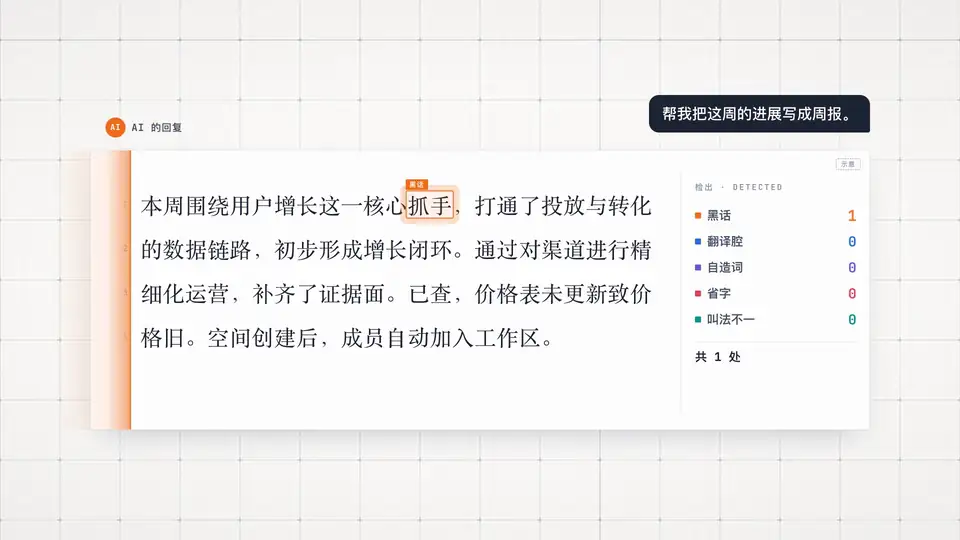

<a id="top"></a>

<div align="center">


<h1> 像人一样说话</h1>

<p><b>让 AI 写出读一遍就懂的中文和英文</b><br>Agent Skill · 支持 Claude Code、Codex、Cursor、GitHub Copilot 等工具 · 中文 + English</p>

<p>
<a href="#install"></a>
<a href="#examples"></a>
<a href="#results"></a>
</p>

<p>
<a href="#install"></a>
<a href="LICENSE"></a>
<a href="#results"></a>
<a href="https://github.com/caredhieacid/talk-like-a-human/stargazers"></a>
<a href="https://github.com/caredhieacid/talk-like-a-human/issues"></a>
</p>

<p><b>中文</b> · <a href="README.en.md">English</a> &nbsp;|&nbsp; <a href="#faq">常见问题</a> · <a href="#contributing">参与贡献</a></p>

<a href="assets/promo-zh.mp4"></a>

<p><sub>▶ 点击上图观看完整宣传片（102 秒，有配乐）。前半段讲 AI 为什么不说人话，后半段介绍这个 skill 怎么解决。</sub></p>

</div>

<details>
<summary><b>目录</b></summary>

- [这是什么](#features)
- [快速开始](#install)
- [效果与测试](#evidence)
- [背景和做法](#how-it-works)
- [进阶：检查项目里的叫法](#glossary)
- [常见问题](#faq)
- [参与贡献](#contributing)

</details>

## <a id="features"></a> 这是什么

AI 写的东西常常让人读不懂：满是“赋能”“闭环”这类说不清具体意思的词，句子像翻译过来的，为了省字把主语删掉，同一个东西前后换好几个名字，还会编出你没给过的数字。

**像人一样说话**是一套写作规则，中文和英文都管。它是一个带 `SKILL.md` 的文件夹，这种格式叫 Agent Skills，Claude Code、Codex、Cursor、GitHub Copilot、Gemini CLI 等工具都能直接加载。装上以后，AI 写聊天回复、周报、文档、commit message 时会按这套规则写；你也可以让它改已有的稿子。

<a href="assets/rewrite-actions-zh.jpg"></a>

装上以后，AI 会这样写：

-  说具体的事。把“赋能客服团队”写成“客服能自己查订单状态”；说不出具体做了什么，就标出来问你。
-  用大家都懂的词。自己造的新词（比如“证据面”）展开成一句话，“回滚”“幂等”这类术语照常用。
-  句子通顺、完整。“对数据进行了清洗”写成“清洗了数据”，笔记里为了省字删掉的主语和“因为”“所以”会补回来。
-  一个东西一个叫法。从头到尾用同一个名字，并且和项目里已有的叫法一致。
-  只写有根据的事。原文的数字原样保留，没给的数字和细节不编，推出来的会说明。
-  只留读者用得上的提醒。真正的不确定和风险写具体，只为给自己留后路的话删掉。[什么是防御性写法？](#defensive)
-  去掉 AI 腔。“这不是……而是……”“这一点非常重要”这样的写法，读者一眼就能认出是 AI 写的，换成具体内容。
-  指出问题后直接给改好的版本，不在里面注明“（没有××）”，也不改到另一个极端。[什么是“东坡肉”问题？](#dongpo)

## <a id="install"></a><a id="安装和使用"></a> 快速开始

### 安装

先把仓库下载到本地：

```bash
git clone https://github.com/caredhieacid/talk-like-a-human.git
cd talk-like-a-human
```

各个工具读取 skill 的目录不同。在表里找到你用的工具，把仓库里的 `talk-like-a-human` 文件夹链接过去：

| 工具 | 放在哪个目录 |
| --- | --- |
| Codex、Cursor、GitHub Copilot、Gemini CLI、OpenCode、Amp、Goose、Zed、Devin Desktop（原 Windsurf） | `~/.agents/skills/` |
| Claude Code | `~/.claude/skills/` |
| Cline | `~/.cline/skills/` |
| Kiro | `~/.kiro/skills/` |

比如用 Cursor、Codex 这些工具，在刚才的仓库目录里运行：

```bash
mkdir -p ~/.agents/skills
ln -s "$PWD/talk-like-a-human" ~/.agents/skills/talk-like-a-human
```

用 Claude Code，就把两处 `~/.agents` 换成 `~/.claude`。同时用几个工具，每个目录各建一个链接。命令里的 `$PWD` 指当前目录，所以要在仓库目录里运行。

> [!TIP]
> 用链接安装的话，以后在仓库里运行 `git pull`，skill 会跟着更新。只想在某个项目里用，就把文件夹复制或链接到那个项目的 `.agents/skills/`（Claude Code 是 `.claude/skills/`）。
>
> 不支持 skill 的工具也能用：Aider 可以运行 `aider --read 仓库路径/talk-like-a-human/SKILL.md`；其他工具可以在它的规则文件（比如 `AGENTS.md`）里写一句“写给人看的文字，按 /你的仓库路径/talk-like-a-human/SKILL.md 的规则写”，路径要写完整。

表里的目录来自各工具 2026 年 10 月的官方文档。我们实际装过的是 Claude Code 和 Codex。

### 使用

装好以后，AI 觉得需要时会自己用上这套规则。也可以直接说：

- “帮我把这段改成人话”
- “这份周报老板看不懂，改一下”
- “这几篇文档里同一个东西叫法不一样，帮我统一”

支持斜杠命令的工具可以直接点名，比如在 Claude Code 里输入 `/talk-like-a-human 把上面那段改成人话`。

> [!NOTE]
> AI 不一定每次都会自己加载。我们测试时，Codex 写任务完成后的汇报，3 次都没有加载。想让每条回复都用上，在工具的全局说明文件里加一句：`写给人看的文字，都按 talk-like-a-human skill 来写。` Claude Code 是 `~/.claude/CLAUDE.md`，Codex 是 `~/.codex/AGENTS.md`，其他工具见各自的文档。

## <a id="evidence"></a> 效果与测试

<a href="assets/rewrite-connections-zh.jpg"></a>

### <a id="examples"></a><a id="效果对比"></a>效果对比

下面的例子都摘自 Claude Opus 5.5 测试时的回复原文。

#### 不把猜测写成事实

用户让 Claude 把这段周报改成人话：

> 本周围绕用户增长这一核心抓手，打通了投放与转化的数据链路，初步形成增长闭环。通过对渠道进行精细化运营，赋能销售团队，沉淀了一套可复用的方法论。……

<table>
<tr>
<th width="50%"> 不装 skill</th>
<th width="50%"> 装了 skill</th>
</tr>
<tr>
<td>把广告投放数据和用户转化数据接到了一起。现在能看到每个渠道花了多少钱、带来了多少【注册/付费】用户，可以按效果调整投放。</td>
<td>本周主要做用户增长，把投放数据和转化数据连了起来，现在能看到【待确认：连起来以后能看到什么】。</td>
</tr>
</table>

不装 skill 的版本看起来更具体，但“能看到每个渠道花了多少钱”是 Claude 猜的，原文没说，老板读到会当真。装了 skill 的版本把原文没说的标出来，请你补。

<details>
<summary><b> 更多对比：原始数字、完整句子和方案成本</b></summary>

#### 保留原始数字

更新日志里写的是 `perf: dashboard initial load 4.1s -> 1.3s`，意思是仪表盘（dashboard）第一次打开的时间从 4.1 秒降到了 1.3 秒。用户让 Claude 据此写一段给客户看的更新说明：

<table>
<tr>
<th width="50%"> 不装 skill</th>
<th width="50%"> 装了 skill</th>
</tr>
<tr>
<td>Your dashboard now opens about three times faster.</td>
<td>The dashboard now loads in 1.3 seconds when you first open it, down from 4.1 seconds.</td>
</tr>
</table>

换算成“快了约三倍”以后，客户就看不到实际要等几秒了。前三轮测试里，不装 skill 每次都这样换算；装了 skill 保留了原来的数字。

#### 句子要完整

用户的要求是：“把我的笔记整理成一条发给产品经理小林的消息，说明昨天报价页显示旧价格的问题。”笔记写得很省字。这个例子只展示装了 skill 的结果：

**用户给的笔记**

> 已查。缓存未失效致价格旧。加 TTL 5min，已在测试环境验。待小林确认新价格规则后发生产。回滚：删 TTL 配置即可。

** 装了 skill 后写出的消息**

> 小林，昨天报价页显示旧价格的问题我查清楚了，修复已经在测试环境验证过，等你确认新的价格规则后就发布到生产环境。
>
> 原因是缓存没有失效，所以报价页显示的还是缓存里的旧价格。我给这个缓存加了 5 分钟的过期时间（TTL），这样价格更新后，报价页最多过 5 分钟就会显示新价格。
>
> 你确认好新的价格规则后跟我说一声，我就发布。发布后如果有问题，删掉这条 TTL 配置就能回滚。

笔记里省掉的“我”、“所以”和谁来做什么都补上了。“最多过 5 分钟”是 Claude 根据过期时间推出来的，它在回复末尾单独告诉了用户。

#### 写方案时不自己编成本

用户让 Claude 写一份给技术负责人的方案，只给了三个数：每年省 30 万元软件授权费、需要 2 个后端开发、做 3 个月。

<table>
<tr>
<th width="50%"> 不装 skill</th>
<th width="50%"> 装了 skill</th>
</tr>
<tr>
<td>上线后每年省下 30 万元授权费，扣除维护成本，预计上线后约 16 个月收回开发投入。</td>
<td>开发：2 名后端开发，3 个月，人力成本约【待确认：金额】万元。</td>
</tr>
</table>

不装 skill 的版本里，每人每月成本、维护成本和“16 个月收回投入”都是 Claude 自己估的。装了 skill 的版本把没给的成本留空，请你填。

</details>

### <a id="results"></a><a id="测试结果"></a>测试结果

[`evals/`](talk-like-a-human/evals/) 里有 21 个测试用例、89 条检查项，其中 6 个是英文的。每个用例在两种配置下各跑一次，再由编写 skill 的同一个 Claude 按检查项评分，所以下面是自测结果。前两轮用来修改规则，表里从第 3 轮开始；第 4、5 轮的对照组是不含这一轮新规则的上一版。

| 轮次 | 测什么 | 模型 | 对照组 | 装了 skill |
| --- | --- | --- | :---: | :---: |
| 第 3 轮 | 12 个基础用例：用词、句子、事实、叫法 | Claude Opus 5.5 | 不装：43 / 52 | **52 / 52** |
| 第 4 轮 | 3 个用例：语病、“东坡肉” | Claude Opus 5.5 | 上一版：13 / 13 | 13 / 13 |
| 第 5 轮 | 6 个用例：防御性写法、AI 腔 | Claude Opus 5.5 | 上一版：24 / 24 | 24 / 24 |
| 第 5 轮 | LinkedIn 发布帖，跑 3 次 | Codex | 不装：3 次分别得 2、3、3 分（满分 4） | **3 次都全部通过** |

第 4、5 轮新加的规则在 Claude 上还没测出效果，因为上一版规则也能全部通过。Codex 上差别明显，不装 skill 时，3 篇发布帖的结尾都是“Ideas don't wait for a connection”这类口号或“excited to”。

第 3 轮里，装了 skill 平均每个用例 72 秒、约 6.7 万 token，不装是 37 秒、约 5.6 万 token。多出来的是读规则和自查的时间。

#### 复现测试

测试用例用的是 `claude plugin eval` 的格式。用 Claude Code 2.1.269 或更新版本，从仓库根目录运行下面的命令就能复现（`--scaffold` 会自动准备测试需要的示例文件）。用其他工具的话，把用例里的 `prompt.md` 交给 AI，再按 `graders/` 里的标准检查回复。

```bash
cd talk-like-a-human
claude plugin eval . --allow-tools Write,Edit,Bash --scaffold
```

## <a id="how-it-works"></a><a id="这个-skill-是怎么起作用的"></a> 背景和做法

### <a id="research"></a><a id="为什么-ai-会这样写"></a>为什么 AI 会这样写

下面这些毛病，多半是训练方式和平时的用法造成的：

| 毛病 | 主要原因 |
| --- | --- |
| 黑话多、句子长 | 训练时，给回答打分的人常常挑更长、更正式、听起来更专业的那个 |
| 套话多 | 训练让模型越来越爱用最常见的说法 |
| 中文像翻译过来的 | 中文训练材料比英文少得多，不少是从英文翻译过来的 |
| 为了省字删掉主语 | 用户和软件常要求 AI“简洁”“少用字”，最省事的做法就是删主语和“因为”“所以” |
| 同一个东西换着叫 | AI 记不住上一次对话说过什么；一次对话太长，也会忘掉前面定好的叫法 |
| 满篇免责声明和“可能” | 安全训练鼓励加提醒和免责声明；可是研究发现，真正拿不准的内容，模型反而常常说得很肯定 |
| 一眼就能认出的 AI 腔 | 模型学到的是“好回答的样子”：先否定一个没人说过的说法再亮出观点，段末点明“这很重要”，几百字也切成好几节 |

每条原因的证据和出处见 [`research/why-ai-writes-this-way.md`](research/why-ai-writes-this-way.md)。同类 skill 和工具的调研见 [`research/similar-skills.md`](research/similar-skills.md)。

### <a id="process"></a>skill 让 AI 怎么写

AI 动笔前先想清楚结论和具体事实，写完再对照自查清单改一遍。超过一页的重要文档，如果工具能开子 agent，还会另开一个没看过前面对话的 AI 来读，它读不懂、读错的地方就是要改的地方。


<p align="center"><b>想清楚</b> → <b>写出来</b> → <b>对照清单改一遍</b></p>

完整规则和自查清单在 [`talk-like-a-human/SKILL.md`](talk-like-a-human/SKILL.md)。[`references/`](talk-like-a-human/references/) 里有中英文黑话对照表，以及防御性写法和 AI 腔的完整清单，AI 改稿或拿不准时才去查。

### <a id="defensive"></a>什么是防御性写法

防御性的话是写的人为了“万一错了不怪我”加上去的，比如“仅供参考”“建议上线前充分测试”。读的人从里面得不到能用的信息；满篇都是提醒，反而分不清哪一句要紧。

| 防御性的写法（示意） | 应该的写法 |
| --- | --- |
| 已修复登录超时问题。可能还存在其他边界情况，建议上线前充分测试。 | 登录超时修好了，在 Chrome 上测过。Safari 没测；手机端走的是另一套登录接口，这次没改。 |

对每句提醒，skill 让 AI 先问：删掉它，读者会少知道什么吗？会，就像表格里“应该的写法”那样写具体；不会，就删掉。

### <a id="dongpo"></a>什么是“东坡肉”问题

让 AI 做一道西红柿炒鸡蛋，它多放了一块东坡肉。你说“别放东坡肉”，下一盘端上来的是“西红柿炒鸡蛋（没有东坡肉）”，之后每改一次，都要再强调一句“不含东坡肉”。

写文字也会这样：

| 改过头的写法（示意） | 应该的写法 |
| --- | --- |
| 以下是去掉黑话的版本：本周我们把投放数据和转化数据连了起来（没有使用“打通”“闭环”等说法）。 | 本周我们把投放数据和转化数据连了起来。 |

读最终版本的人根本不知道之前出过什么问题，括号里的说明只是新的噪音。另一种改过头是走到反面：嫌太正式就改成网络口语，嫌太长就连主语也删了。

## <a id="glossary"></a><a id="大项目检查叫法是否统一"></a> 进阶：检查项目里的叫法

项目大了，同一个东西很容易被不同的人叫成不同的名字。skill 带了一个检查脚本，按你的术语表找出文档和代码里叫错的地方，也能放进 CI（提交代码时自动运行的检查）。

### 准备术语表

先在你的项目里写一份术语表，规定每个东西叫什么（模板见 [`glossary-template.md`](talk-like-a-human/references/glossary-template.md)）：

```markdown
| 标准叫法 | 不要用的叫法 | 例外 |
| --- | --- | --- |
| 工作区 | 空间、团队空间、workspace | 存储空间 |
| 成员 | 组员、账号 | 账号密码 |
```

“例外”一栏写的是正常用法，比如“存储空间”里的“空间”不算叫错，脚本不会报。

### 运行检查

在你的项目文件夹里运行下面的命令，把 `GLOSSARY.md` 和 `docs/` 换成你的术语表和文档目录；skill 装在别的目录的话，脚本路径也要换。脚本只需要 Python 3，不用另外安装东西。下面是在一个示例项目里运行的结果：

```console
$ python3 ~/.agents/skills/talk-like-a-human/scripts/check_terms.py --glossary GLOSSARY.md docs/
docs/billing.md:1: 用了「空间」，统一用「工作区」
docs/billing.md:2: 用了「账号」，统一用「成员」
docs/members.md:1: 用了「团队空间」，统一用「工作区」
docs/members.md:1: 用了「组员」，统一用「成员」
叫法不统一 4 处
```

发现叫错的地方时，脚本的退出码是 1，所以放进 CI 以后，有人写错叫法就会报错。

### 统计不同叫法

还没定用哪个叫法时，加 `--count` 先看看每种叫法用了几次、在哪些文件：

```console
$ python3 ~/.agents/skills/talk-like-a-human/scripts/check_terms.py --glossary GLOSSARY.md --count docs/
■ 工作区
    工作区（标准叫法）：1 次，在 docs/billing.md
    空间：1 次，在 docs/billing.md
    团队空间：1 次，在 docs/members.md
    workspace：0 次
■ 成员
    成员（标准叫法）：0 次
    组员：1 次，在 docs/members.md
    账号：1 次，在 docs/billing.md
```

## <a id="faq"></a><a id="常见问题"></a> 常见问题

<details>
<summary><b>会把专业术语换成大白话吗？</b></summary>

不会。“缓存”“回滚”“幂等”这类意思明确的术语会保留。只有写给不懂技术的人看时，才在术语第一次出现的地方加一句解释。测试里有一个用例专门检查这一点：给后端同事的设计说明改完以后，术语和数字一个都不能少。

</details>

<details>
<summary><b>回复会变长吗？</b></summary>

省字的笔记改完会长一点，因为要补回主语和“因为”“所以”。啰嗦的稿子改完会短一点，因为客套、重复和给自己留后路的话会删掉。

</details>

<details>
<summary><b>和“去 AI 味”的工具有什么不同？</b></summary>

humanizer（GitHub 上很热门的一个英文改写 skill）这类工具，主要改你贴进去的稿子，目标是让文字看起来不像 AI 写的，有些还会禁用破折号、轮换近义词。

这个 skill 管 AI 写的所有文字，目标是读一遍就懂。它也去 AI 腔，但只改让文字变空的写法。同一个东西始终用同一个名字，因为换了名字，读者会以为说的是另一样东西。

</details>

## <a id="contributing"></a><a id="参与改进"></a> 参与贡献

欢迎通过 issue 和 PR 参与项目：

- 分享真实写作场景与改写案例
- 补充中英文用词对照
- 改进写作规则与测试用例

`main` 分支受保护：所有改动都要通过 PR，经维护者审核、自动检查通过后才能合并。原因和具体要求见 [CONTRIBUTING.md](CONTRIBUTING.md)。

 [分享例子](https://github.com/caredhieacid/talk-like-a-human/issues/new) ·  [反馈问题](https://github.com/caredhieacid/talk-like-a-human/issues) ·  [查看 PR](https://github.com/caredhieacid/talk-like-a-human/pulls)

<details>
<summary><b>仓库里有什么</b></summary>

```text
talk-like-a-human/
├── talk-like-a-human/          # skill 文件夹，安装的就是它
│   ├── SKILL.md                # 规则、例子和自查清单
│   ├── references/             # 中英文黑话对照表、防御性写法和 AI 腔清单、术语表模板
│   ├── scripts/check_terms.py  # 检查叫法是否统一的脚本
│   └── evals/                  # 21 个测试用例
├── research/                   # 两份调研报告
├── assets/                     # README 用的图片
├── .github/                    # 自动检查、CODEOWNERS、PR 模板
└── CONTRIBUTING.md             # 参与贡献和合并规则
```

</details>

### <a id="stars"></a><a id="star-历史"></a>Star 历史

<div align="center">

如果这个 skill 对你有用，欢迎点个 ，让更多人找到它。

<a href="https://star-history.com/#caredhieacid/talk-like-a-human&Date">
  
</a>

</div>

### <a id="license"></a><a id="许可"></a>许可

[MIT](LICENSE)

<p align="center"><a href="#top">回到顶部</a></p>
